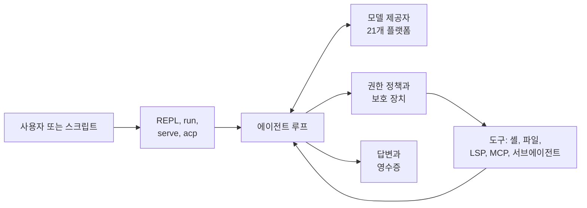

<p align="center">
  
</p>

<p align="center">
  <strong>21개 AI 플랫폼을 하나로 쓰는 터미널 코딩 에이전트</strong>
</p>

<p align="center">
  <a href="#설치"></a>
  
  
  
  
  <a href="https://github.com/JinHo-von-Choi/nerdvana-cli"></a>
</p>

<p align="center">
  <a href="README.md">English</a> | 한국어
</p>

---

터미널에서 쓰는 AI 코딩 에이전트입니다. Claude, GPT, Gemini부터 내 컴퓨터의 Ollama까지, 21개 플랫폼의 모델을 같은 방식으로 씁니다.

## 장점

- **모델에 묶이지 않습니다.** 모델을 바꿔도 명령, 권한 설정, 스크립트를 그대로 씁니다. 특정 모델이 응답하지 않으면 미리 지정해 둔 다른 모델로 자동 전환됩니다.
- **코드를 망가뜨리지 않습니다.** 읽은 뒤 변경된 파일은 건드리지 않고, 편집 직후 새로 생긴 오류를 즉시 알려 줍니다.
- **위험한 작업은 막힙니다.** 승인 모드와 샌드박스로 작업 범위를 제한합니다. `.env` 같은 비밀 파일은 어떤 설정에서도 모델이 쓸 수 없습니다.
- **사람이 없어도 돌아갑니다.** `nerdvana run`은 JSON 결과, 비용·턴 상한, 완료 여부를 판정하는 `--verify` 명령을 갖추고 있어 CI와 스크립트에 바로 붙습니다.
- **오래 걸리는 일은 맡겨 두면 됩니다.** 터미널을 닫아도 계속 실행되는 백그라운드 모드, cron 예약, 여러 에이전트가 나눠 처리하는 워크플로를 지원합니다.
- **다른 도구와 이어집니다.** MCP 서버를 도구로 붙이거나, 반대로 NerdVana의 도구를 다른 에이전트나 Zed 같은 편집기에 제공할 수 있습니다.
- **비용이 보입니다.** 요청마다 토큰과 비용을 기록하며, `nerdvana cost`로 세부 내역을 확인합니다.

## 동작 방식



요청을 받으면 모델이 필요한 도구를 고르고, 에이전트가 권한을 확인한 뒤 실행합니다. 작업이 끝날 때까지 이 과정을 되풀이하고, 단발 실행은 바뀐 파일과 비용을 담은 결과를 남깁니다.

## 설치

필요 조건: Python 3.11 이상, git.

```bash
curl -fsSL https://raw.githubusercontent.com/JinHo-von-Choi/nerdvana-cli/main/install.sh | bash
```

설치 스크립트는 `~/.nerdvana-cli/`에 전용 가상 환경을 만들고, `nerdvana`와 `nc` 명령을 PATH에 등록합니다. 업그레이드는 `nerdvana update` 한 줄로 됩니다.

소스에서 설치:

```bash
git clone https://github.com/JinHo-von-Choi/nerdvana-cli.git
cd nerdvana-cli
pip install -e ".[all]"          # 모든 제공자 SDK
# pip install -e ".[anthropic]"  # 제공자 하나만: anthropic, openai, gemini
```

## 빠른 시작

1. 제공자를 고르고 API 키를 넣고 모델을 선택합니다.

   ```bash
   nerdvana setup
   ```

   키를 직접 내보내도 됩니다. 예: `export ANTHROPIC_API_KEY="sk-ant-..."`

2. 프로젝트로 이동해 REPL을 시작합니다.

   ```bash
   cd your-project
   nerdvana
   ```

3. `/init`으로 이 프로젝트의 지침 파일 `NIRNA.md`를 만든 뒤, 할 일을 요청합니다. 예: `이 프로젝트 구조를 설명해 줘`, `tests/test_api.py의 실패하는 시험을 고쳐 줘`.

4. 스크립트·CI에서는 프롬프트 하나만 실행하고 끝냅니다.

   ```bash
   nerdvana run "fix the failing test" --approval-mode yolo --max-cost-usd 2 --output-format json
   ```

한 세션만 다른 제공자나 모델로 쓰려면 `nerdvana --provider openai --model gpt-4.1`처럼 실행하면 됩니다.

## 지원 제공자

| 제공자 | 기본 모델 | API 키 환경 변수 |
|-|-|-|
| **Anthropic** | claude-sonnet-5-5 | `ANTHROPIC_API_KEY` |
| **OpenAI** | gpt-4.1 | `OPENAI_API_KEY` |
| **Google Gemini** | gemini-2.5-flash | `GEMINI_API_KEY` |
| **Groq** | llama-3.3-70b-versatile | `GROQ_API_KEY` |
| **OpenRouter** | anthropic/claude-sonnet-4 | `OPENROUTER_API_KEY` |
| **xAI (Grok)** | grok-3 | `XAI_API_KEY` |
| **Ollama** | qwen3 | `OLLAMA_API_KEY` (Ollama Cloud만) |
| **vLLM** | Qwen/Qwen3-32B | `VLLM_API_KEY` |
| **DeepSeek** | deepseek-chat | `DEEPSEEK_API_KEY` |
| **Mistral** | mistral-medium-latest | `MISTRAL_API_KEY` |
| **Cohere** | command-r-plus | `CO_API_KEY` |
| **Together AI** | Llama-3.3-70B-Instruct-Turbo | `TOGETHER_API_KEY` |
| **ZAI (GLM)** | glm-4.7 | `ZHIPUAI_API_KEY` |
| **Featherless AI** | featherless-llama-3-70b | `FEATHERLESS_API_KEY` |
| **Xiaomi MiMo** | mimo-v2.5-pro | `MIMO_API_KEY` |
| **Moonshot AI (Kimi)** | kimi-k2-instruct | `MOONSHOT_API_KEY` |
| **Alibaba DashScope (Qwen)** | qwen3-coder-plus | `DASHSCOPE_API_KEY` |
| **MiniMax** | MiniMax-M3.1-Flash-Preview | `MINIMAX_API_KEY` |
| **Perplexity** | sonar-pro | `PERPLEXITY_API_KEY` |
| **Fireworks AI** | accounts/fireworks/models/llama-v3p3-70b-instruct | `FIREWORKS_API_KEY` |
| **Cerebras** | llama-3.3-70b | `CEREBRAS_API_KEY` |

로컬 서버: [docs/local-models.md](docs/local-models.md). 제공자별 동작(추론, effort, 캐시): [docs/providers-compat.md](docs/providers-compat.md).

## 설정

설정은 YAML 파일 하나에서 읽습니다. 아래 순서로 파일을 찾고, 처음 발견된 파일을 씁니다.

1. `--config <경로>`
2. `NERDVANA_CONFIG`
3. `./nerdvana.yml` 또는 `./nerdvana.yaml`
4. `~/.nerdvana/config.yml`
5. `~/.config/nerdvana-cli/config.yml` (예전 위치, 계속 읽음)

최소 `nerdvana.yml`:

```yaml
model:
  provider: anthropic
  model: claude-sonnet-5-5
  fallback_models:           # 재시도를 다 쓰면 차례로 시도
    - openai:gpt-4.1         # provider:model 형식이면 제공자도 바뀜

permissions:
  mode: default              # default, accept-edits, bypass, plan
  always_allow: ["FileRead", "Bash(git status)"]
  always_deny: []

sandbox:
  mode: off                  # off, auto, require (Linux Landlock)
```

한 번만 바꿀 설정은 `--set section.field=value`로 넘기면 됩니다. 실제로 적용될 설정과 각 값의 출처는 `nerdvana --dump-config`로 확인하십시오. 절과 필드 전체 목록은 [docs/configuration.md](docs/configuration.md)에, 전체 예시는 [nerdvana.yml.example](nerdvana.yml.example)에 있습니다.

### 환경 변수

| 변수 | 용도 | 기본값 |
|-|-|-|
| `NERDVANA_HOME` | 설치 위치 | `~/.nerdvana-cli` |
| `NERDVANA_DATA_HOME` | 사용자 데이터 위치 | `~/.nerdvana` |
| `NERDVANA_CONFIG` | 설정 파일 경로 | `~/.nerdvana/config.yml` |
| `NERDVANA_NO_UPDATE_CHECK` | `1`이면 시작 시 업데이트 알림을 끔 | 없음 |
| `NERDVANA_EXTERNAL_PROJECTS_ROOT` | 외부 프로젝트 도구가 벗어날 수 없는 경계 | 없음 |
| `NERDVANA_EXTERNAL_PROJECTS_ENABLED` | 설정 파일을 고치지 않고 외부 프로젝트 도구를 등록 | `false` |

API 키는 각 제공자 표에 있는 변수를 씁니다. `BRAVE_API_KEY`가 없으면 `WebSearch` 도구가 동작하지 않습니다. 제공자와 모델은 환경 변수로 지정할 수 없습니다. `--provider`, `--model`, `/provider`, `/model` 또는 설정 파일로 지정하십시오.

### 파일과 디렉터리

```
~/.nerdvana-cli/     설치 위치(git 체크아웃 + venv). install.sh가 관리하므로 직접 고치지 않음
~/.nerdvana/         사용자 데이터 ($NERDVANA_DATA_HOME)
  ├── config.yml     전역 설정
  ├── NIRNA.md       전역 지침
  ├── mcp.json       전역 MCP 서버
  ├── sessions/      대화 기록
  ├── skills/        전역 스킬
  ├── commands/      전역 슬래시 명령
  ├── hooks/         전역 Python 훅
  ├── hooks.yml      전역 셸 명령 훅
  └── agents/        전역 에이전트 정의용 예약 위치
<project>/
  ├── nerdvana.yml   프로젝트 설정
  ├── NIRNA.md       프로젝트 지침 (커밋하지 않을 지침은 NIRNA.local.md)
  ├── .mcp.json      프로젝트 MCP 서버
  └── .nerdvana/     프로젝트 스킬, 명령, 훅, 워크플로
```

업그레이드 후 첫 실행 시 `~/.nerdvana-cli/sessions/`와 예전 위치 `~/.config/nerdvana-cli/`의 데이터를 `~/.nerdvana/`로 한 번 옮깁니다(마이그레이션).

## 권한

모든 도구 호출은 서브에이전트와 백그라운드 에이전트를 포함해 다음 순서로 판정합니다.

1. `permissions.always_deny`: 거부
2. 현재 모드가 제외한 도구: 거부하고 모델에게 숨김
3. 도구 자체의 거부(예: 차단된 셸 명령): 거부
4. `permissions.always_allow`: 묻지 않고 허용
5. 모드의 신뢰 수준: `strict`는 모든 쓰기 전에, `balanced`는 파괴적 도구 전에 묻고, `yolo`는 묻지 않음

이 순서와 별개로, 어떤 훅·규칙·모드로도 끌 수 없는 보호 장치가 있습니다. 이 장치는 `.env`·`.iron-laws.yml` 쓰기, 작업 계약이 보호하는 시험 파일 쓰기, 비밀 파일을 네트워크로 보내는 명령을 항상 거부합니다.

| `--approval-mode` | 신뢰 수준 | 효과 |
|-|-|-|
| `default` | balanced | 일반 대화형 사용 |
| `auto_edit` | balanced | 같은 도구, 편집 중심 프롬프트 |
| `yolo` | yolo | 확인 없음 |
| `plan` | strict | 쓰기 도구와 `Bash`를 숨김 |

터미널이 없으면 확인 질문은 모두 거부로 처리됩니다. 그래서 파일을 쓰는 무인 실행에는 `yolo`가 필요합니다. 자주 승인하는 질문은 `nerdvana approvals`가 `always_allow` 규칙으로 바꿔 쓰도록 제안합니다. 샌드박스: [docs/sandbox.md](docs/sandbox.md). 사용자 설정보다 우선하는 관리자 정책: [docs/managed-policy.md](docs/managed-policy.md).

## 프로젝트 지침

지침은 아래 순서로 시스템 프롬프트에 포함되며, 뒤 항목이 앞 항목보다 우선합니다.

1. `~/.nerdvana/NIRNA.md`: 전역 지침
2. `<project>/NIRNA.md`: 저장소에 커밋하는 프로젝트 지침
3. `<project>/NIRNA.local.md`: 커밋하지 않는 로컬 지침

프로젝트 루트의 `AGENTS.md`와 `CLAUDE.md`는 그 뒤에 읽습니다. 하위 디렉터리 파일을 처음 다룰 때는 해당 디렉터리에서 루트까지 경로의 규칙 파일을 추가로 불러옵니다(세션당 32 KB 한도). `/init`이 `NIRNA.md` 초안을 만듭니다. 스킬: [docs/skills.md](docs/skills.md). 사용자 슬래시 명령: [docs/commands.md](docs/commands.md). 훅: [docs/hooks.md](docs/hooks.md).

## MCP 서버

서버는 `~/.nerdvana/mcp.json`(전역)과 `<project>/.mcp.json`(프로젝트, 같은 이름의 전역 항목을 덮어씀)에 Claude Code와 동일한 `mcpServers` 형식으로 작성합니다.

```json
{
  "mcpServers": {
    "my-server": {
      "transport": "stdio",
      "command": "node",
      "args": ["server.js"],
      "env": { "API_KEY": "${MY_API_KEY}" }
    }
  }
}
```

연결된 서버의 도구는 `mcp__{server}__{tool}` 형식으로 호출합니다. `nerdvana mcp add|list|remove`로 파일을 편집하고, `/mcp`로 연결 상태를 확인할 수 있습니다. 자세한 내용: [docs/mcp-client.md](docs/mcp-client.md), [docs/mcp-deferred-tools.md](docs/mcp-deferred-tools.md). NerdVana 도구를 다른 에이전트에 노출하려면: [docs/mcp-edit-backend.md](docs/mcp-edit-backend.md), [docs/mcp-quota.md](docs/mcp-quota.md).

## 명령 참조

### 기본 명령

| 명령 | 용도 |
|-|-|
| `nerdvana` | 대화형 REPL 시작 |
| `nerdvana run <prompt>` | 프롬프트 하나를 실행하고 종료. 옵션, 종료 코드, JSON 결과는 [docs/headless.md](docs/headless.md) |
| `nerdvana setup` | 제공자 선택, API 키 입력, 모델 선택 |
| `nerdvana providers` | 지원 제공자 목록 |
| `nerdvana version` | 버전 표시 |
| `nerdvana update` | 최신 릴리스 설치(사용자 데이터는 건드리지 않음) |
| `nerdvana doctor` | 설치, 키, 외부 의존성 점검 (`--strict`, `--json`) |
| `nerdvana serve` | stdio 또는 HTTP MCP 서버로 실행 |
| `nerdvana acp` | 편집기용 Agent Client Protocol 에이전트로 실행(`acp` extra 필요). [docs/acp.md](docs/acp.md) |
| `nerdvana review` | 읽기 전용 에이전트로 git 기준점 대비 작업 트리를 리뷰 (`--base`, `--fail-on`). [docs/review.md](docs/review.md) |
| `nerdvana import claude\|codex` | Claude Code·Codex 명령을 `.nerdvana/commands`로 복사하고 변환한 권한 규칙을 출력 (`--write`로 적용) |
| `nerdvana context [id]` | 저장된 세션의 컨텍스트 창 사용 내역 (`--top`, `--json`) |
| `nerdvana cost` | 기간별 토큰 사용량, 캐시 적중률, USD 비용 (`--by provider\|model\|agent\|category\|tool`) |
| `nerdvana approvals` | 반복 승인에서 `always_allow` 규칙을 제안. 아무것도 쓰지 않음 |
| `nerdvana history search "<query>"` | 지난 대화 기록 검색 (`--since 7d`, `--cwd .`, `--limit`). [docs/context-history.md](docs/context-history.md) |

### 백그라운드 에이전트, 예약 실행, 워크플로

| 명령 | 용도 |
|-|-|
| `nerdvana agents start "<prompt>"` | 터미널을 닫아도 계속 도는 백그라운드 실행 시작 (`--worktree`, `--max-cost-usd`, `--key`) |
| `nerdvana agents list` | 실행 목록: 상태, 경과 시간, 비용, 마지막 신호 |
| `nerdvana agents show <id>` | 실행 기록, 로그 끝부분, 결과 |
| `nerdvana agents attach <id>` | 로그 따라 보기. Ctrl+C는 분리만 함 (`--input`이면 입력한 줄을 실행에 메시지로 보냄) |
| `nerdvana agents send <id> "<message>"` | 실행에 메시지 하나를 더 줌. 실행 중이면 지금 프롬프트 다음에 답하고, 끝난 실행은 그 세션을 메시지로 이어 감 |
| `nerdvana agents apply <id>` | `--worktree` 실행이 만든 변경을 시작한 작업 트리에 적용 (`--check`는 적용 가능 여부만 확인) |
| `nerdvana agents stop <id>` | 실행 중지 |
| `nerdvana agents resume <id>` | 고아·중지·실패한 실행을 대화 기록에서 다시 시작 |
| `nerdvana agents clean` | `--days`일 전에 끝난 실행 기록 삭제(기본 7) |
| `nerdvana schedule add "<cron or every 15m>" --prompt "..."` | 작업 추가. 따로 정하지 않으면 읽기 전용이며 비용 상한이 있음 |
| `nerdvana schedule list` | 작업 목록, 다음 실행, 마지막 결과 |
| `nerdvana schedule remove <name>` | 작업 삭제 |
| `nerdvana schedule run <name>` | 작업을 지금 한 번 실행 |
| `nerdvana schedule daemon` | 때가 된 작업을 전경에서 실행(작업별·일별 비용 상한) |
| `nerdvana schedule install-systemd` | 데몬용 systemd 사용자 유닛 출력 |
| `nerdvana workflow list` | 프로젝트·사용자·내장 워크플로 목록 |
| `nerdvana workflow show <name>` | 워크플로 입력과 단계 표시 |
| `nerdvana workflow run <name>` | 워크플로 실행 (`--input k=v`, `--max-cost-usd`, `--resume <run-id>`) |

안내서: [docs/background.md](docs/background.md), [docs/scheduling.md](docs/scheduling.md), [docs/workflows.md](docs/workflows.md).

### 세션, 메모리, 스킬, 플러그인, MCP, 훅, ACL

| 명령 | 용도 |
|-|-|
| `nerdvana session list` | `~/.nerdvana/sessions/`에 저장된 대화 기록 목록 |
| `nerdvana session resume <id>` | 대화 기록으로 REPL 다시 열기 |
| `nerdvana session fork <id>` | 대화 기록을 새 id로 복사. 원본은 그대로 두고 갈래를 이어 감 |
| `nerdvana session purge` | 저장된 대화 기록 삭제 |
| `nerdvana memory list` | 프로젝트 메모리 목록 |
| `nerdvana memory add <text>` | 메모리 기록 |
| `nerdvana memory remove <id>` | 메모리 하나 삭제 |
| `nerdvana memory purge` | 선택한 범위의 메모리 전부 삭제 |
| `nerdvana memory inbox` | 에이전트가 제안한 메모리를 diff와 함께 표시 (`memory.review: true`) |
| `nerdvana memory approve <id>` | 제안 적용 (`--all`은 전부) |
| `nerdvana memory reject <id>` | 제안 버림 |
| `nerdvana memory forget <name>` | 메모리를 삭제하고 감사 기록에 남김 |
| `nerdvana memory stale` | `--days N`일 동안 쓰지 않은 메모리 목록 (`--remove`로 삭제) |
| `nerdvana skill list` | 내장·전역·프로젝트 스킬 목록 |
| `nerdvana skill show <name>` | 스킬 내용 출력 |
| `nerdvana skill install <source>` | `~/.nerdvana/skills/`에 스킬 설치 |
| `nerdvana skill remove <name>` | 설치한 스킬 삭제 |
| `nerdvana skill trust <path>` | 프로젝트 스킬을 승인해 읽을 수 있게 함 |
| `nerdvana plugin install <폴더 또는 git URL>` | 플러그인의 스킬·슬래시 명령·MCP 서버를 한 번에 설치 (`--allow-hooks`면 셸 훅도 추가). [docs/plugins.md](docs/plugins.md) |
| `nerdvana plugin list` | 설치한 플러그인 목록 |
| `nerdvana plugin remove <name>` | 플러그인이 설치한 것만 정확히 제거 |
| `nerdvana mcp list` | 설정된 MCP 서버 목록 |
| `nerdvana mcp add <name>` | 서버 항목 추가 |
| `nerdvana mcp remove <name>` | 서버 항목 삭제 |
| `nerdvana hook list` | 훅 이벤트 종류 목록 |
| `nerdvana hook trust <path>` | 프로젝트 훅 승인 |
| `nerdvana hook revoke <path>` | 프로젝트 훅 승인 취소 |
| `nerdvana hook trusted` | 승인한 프로젝트 훅 목록, 내용이 바뀐 훅 표시 |
| `nerdvana hook pre-tool-use` | 다른 에이전트용 훅 브리지: stdin으로 pre-tool-use 이벤트를 받아 stdout으로 응답 |
| `nerdvana hook post-tool-use` | 훅 브리지: post-tool-use 이벤트 |
| `nerdvana hook prompt-submit` | 훅 브리지: prompt-submit 이벤트 |
| `nerdvana admin acl list` | MCP 서버 클라이언트와 역할 목록 |
| `nerdvana admin acl add <client> <roles>` | 클라이언트 역할 추가·변경 |
| `nerdvana admin acl revoke <prefix>` | 이름이 접두사와 맞는 클라이언트 권한 취소 |

안내서: [docs/memory.md](docs/memory.md), [docs/skills.md](docs/skills.md), [docs/hooks.md](docs/hooks.md).

### REPL 슬래시 명령

| 명령 | 설명 |
|-|-|
| `/help` | 도움말 |
| `/clear` | 대화 화면 지우기 |
| `/init` | `NIRNA.md` 생성 (별칭 `/setup`) |
| `/model`, `/models` | 모델 확인·변경, 제공자의 모델 목록 |
| `/provider` | 제공자 추가·전환 |
| `/mode` | 모드 프로필 전환 |
| `/context` | 컨텍스트 창 사용 내역. `/context <name>`은 컨텍스트 프로필 지정 |
| `/tokens` | 토큰 사용량 |
| `/tools`, `/skills`, `/mcp` | 도구 목록, 스킬 목록, MCP 서버 상태 |
| `/memories`, `/memory` | 메모리 목록, 제안 검토 (`inbox`, `approve`, `reject`, `forget`, `stale`) |
| `/undo`, `/redo`, `/checkpoints` | 편집 git 체크포인트 복원, 재적용, 목록 |
| `/rewind [N]` | 마지막 N개 프롬프트 이전으로 돌아가고 그 사이 도구 편집을 되돌림 |
| `/image <path> ... <question>` | 이미지 파일을 보고 답하기 |
| `/history <query>` | 지난 대화 기록 검색 |
| `/btw <question>` | 대화 기록에 남기지 않는 곁가지 질문 |
| `/steer <text>` | 진행 중인 단계를 끊고 입력한 글로 이어 감 (Ctrl+T) |
| `/goal <objective> --verify <command>` | 명령이 통과할 때까지 작업을 이어 감. `pause`, `resume`, `clear` |
| `/policy` | 적용 중인 관리자 정책 파일 |
| `/route-knowledge` | 내용에 맞는 메모리 범위 제안 |
| `/dashboard`, `/health` | 관측 대시보드, 7일간 도구 호출 상태 |
| `/thinking`, `/activity` | 추론 표시와 활동 표시기 켜고 끄기 |
| `/update` | 업데이트 확인·설치 (`/update parism`은 Parism 갱신) |
| `/quit` | 종료 (`/exit`, `/q`) |

### 내장 도구

레지스트리에는 32개 내장 도구가 있습니다. LSP·심볼 도구는 언어 서버가 설치되어 있을 때만, `Parism`은 MCP 패키지에 접근할 수 있을 때만, 외부 프로젝트 도구 3종은 `external_projects_enabled: true`일 때만 나타납니다.

| 도구 | 유형 | 설명 |
|-|-|-|
| `Bash` | Write | 셸 명령 실행 |
| `FileRead` | Read | `N#hhhhhh` 줄 앵커와 함께 파일을 읽고 다이제스트를 기록 |
| `FileWrite` | Write | 파일 생성, 또는 이 세션에서 읽은 뒤 바뀌지 않은 파일 덮어쓰기 |
| `FileEdit` | Write | 문자열 또는 앵커 치환. 읽은 뒤 파일이 바뀌었으면 거부 |
| `Glob` | Read | 패턴으로 파일 찾기 |
| `Grep` | Read | 정규식으로 내용 검색 |
| `run_code` | Read | 읽기 전용 도구를 묶은 샌드박스에서 짧은 Python 프로그램을 실행해, 여러 파일에 걸친 질문을 호출 한 번으로 답함 |
| `TodoWrite` | Write | 에이전트가 처리할 작업 목록 관리 |
| `ActivateSkill` | Meta | 카탈로그에서 스킬 지침 불러오기 |
| `AskUser` | Meta | 추천 답과 함께 사용자에게 질문 |
| `WebFetch` | Read | URL을 읽기 쉬운 텍스트로 가져오기 |
| `WebSearch` | Read | Brave 검색 (`BRAVE_API_KEY` 필요) |
| `Parism` | Write | JSON 출력의 구조화된 셸 실행 (허용 명령 44개) |
| `Agent` | Write | 서브에이전트를 전경 또는 백그라운드에서 시작 |
| `Swarm` | Write | 공유 예산 안에서 여러 에이전트를 병렬 실행 |
| `TaskGet` | Read | 백그라운드 작업의 상태와 결과 |
| `TaskStop` | Write | 실행 중인 에이전트 작업 취소 |
| `lsp_diagnostics` | Read | 언어 서버 진단 |
| `lsp_goto_definition` | Read | 심볼 정의로 이동 |
| `lsp_find_references` | Read | 심볼 참조 목록 |
| `lsp_rename` | Write | 워크스페이스 전체 이름 바꾸기 |
| `symbol_overview` | Read | 파일·디렉터리의 심볼 지도 |
| `find_symbol` | Read | 이름 경로로 심볼 찾기, 본문 포함 가능 |
| `find_referencing_symbols` | Read | 심볼을 참조하는 심볼 |
| `restart_language_server` | Write | 언어 서버 재시작 |
| `replace_symbol_body` | Write | 심볼 본문 전체 교체 |
| `insert_before_symbol` | Write | 심볼 앞에 코드 삽입 |
| `insert_after_symbol` | Write | 심볼 뒤에 코드 삽입 |
| `safe_delete_symbol` | Write | 참조가 남지 않은 심볼 삭제 |
| `ListQueryableProjects` | Read | 등록된 외부 프로젝트 목록 |
| `RegisterExternalProject` | Write | 위임 질의용 외부 프로젝트 등록 |
| `QueryExternalProject` | Read | 등록된 프로젝트에서 격리된 하위 프로세스로 질의 실행 |

### 에이전트 유형

`Agent`와 `Swarm`은 아래 프로필을 씁니다. `*`는 생성·작업 제어·`AskUser`를 뺀 세션의 모든 도구, `@read`는 모든 읽기 전용 도구를 뜻합니다.

| 에이전트 유형 (agent) | 최대 턴 (max turns) | 허용 도구 | 용도 |
|-|-|-|-|
| `general-purpose` | 50 | `*` | 기본 에이전트 |
| `Explore` | 12 | `Glob`, `Grep`, `FileRead`, `@read` | 읽기 전용 탐색 |
| `Plan` | 15 | `Glob`, `Grep`, `FileRead`, `@read` | 읽기 전용 계획 |
| `code-reviewer` | 12 | `FileRead`, `Grep`, `Glob`, `@read` | 쓰기 없는 리뷰 |
| `git-management` | 20 | `Bash`, `FileRead` | 브랜치, 커밋, 병합 |
| `test-writer` | 30 | `*` | 시험 작성과 실행 |

서브에이전트는 세션의 언어 서버와 MCP 연결을 함께 쓰고, 같은 권한 정책을 따르며, 다른 에이전트를 시작할 수 없습니다. 사용자 정의 에이전트: [docs/agents.md](docs/agents.md).

## 한계

- PyPI에는 배포되지 않습니다. 설치 스크립트나 소스로 설치합니다.
- LSP·심볼 도구는 해당 언어의 언어 서버가 설치되어 있어야 합니다.
- 셸 샌드박스와 `run_code`는 Linux Landlock이 필요하고, TCP 차단은 Linux 6.7 이상에서만 됩니다.
- `--max-cost-usd`는 모델 가격을 알아야 동작합니다. `--max-total-tokens`는 모든 모델에서 동작합니다.
- 터미널이 없으면 모든 확인 질문은 거부가 됩니다.

## 문서

| 주제 | 문서 |
|-|-|
| 모든 설정 | [docs/configuration.md](docs/configuration.md) |
| 헤드리스 실행과 JSON 결과 | [docs/headless.md](docs/headless.md) |
| 재시도, 대체 모델, 출력 한도 | [docs/recovery.md](docs/recovery.md) |
| 샌드박스, 비밀값, 보안 정책 | [docs/sandbox.md](docs/sandbox.md), [docs/secret-masking.md](docs/secret-masking.md), [docs/security.md](docs/security.md) |
| 에이전트, 목표, 조언자 | [docs/agents.md](docs/agents.md), [docs/goals.md](docs/goals.md), [docs/advisor.md](docs/advisor.md) |
| 관측과 OpenTelemetry | [docs/observability.md](docs/observability.md) |
| GitHub 댓글 실행 | [docs/github-action.md](docs/github-action.md) |
| 플러그인 | [docs/plugins.md](docs/plugins.md) |
| 패키지 구조 | [docs/architecture.md](docs/architecture.md) |
| 실제 제공자 시험 | [docs/testing-live.md](docs/testing-live.md) |
| 벤치마크 | [docs/benchmarks/](docs/benchmarks/) |
| 릴리스 노트 | [CHANGELOG.md](CHANGELOG.md) |

docs 아래 안내서는 영어로 작성되어 있습니다.

## 기여

```bash
uv sync --extra dev --extra mcp
pre-commit install
uv run pytest -m "not lsp_integration and not live" -q
```

개발 환경과 PR 관문: [CONTRIBUTING.md](CONTRIBUTING.md).

## 라이선스

MIT

---

<p align="center">
  Made by <a href="mailto:jinho.von.choi@nerdvana.kr">Jinho Choi</a> &nbsp;|&nbsp;
  <a href="https://buymeacoffee.com/jinho.von.choi">Buy me a coffee</a>
</p>
