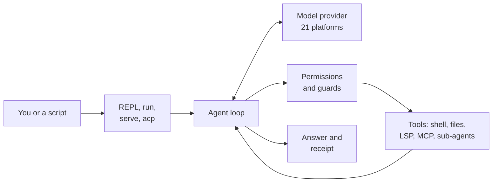

<p align="center">
  
</p>

<p align="center">
  <strong>One terminal coding agent for 21 AI platforms</strong>
</p>

<p align="center">
  <a href="#installation"></a>
  
  
  
  
  <a href="https://github.com/JinHo-von-Choi/nerdvana-cli"></a>
</p>

<p align="center">
  English | <a href="README.ko.md">한국어</a>
</p>

---

A coding agent for your terminal. Use models from 21 platforms, from Claude, GPT and Gemini to Ollama on your own machine, all the same way.

## Why NerdVana CLI

- **No lock-in to one model.** Switch models and keep your commands, permission rules and scripts. When a model stops answering, the agent moves on to the fallback you named.
- **Edits that don't break your code.** A file that changed since it was read is not edited, and errors an edit introduces are reported right away.
- **Risky actions are blocked.** Approval modes and a sandbox set what the agent may do. Secret files such as `.env` are never written by the model, whatever the settings.
- **Runs without you.** `nerdvana run` has JSON output, cost and turn limits, and a `--verify` command that decides when a task is done, so it drops straight into CI and scripts.
- **Hand off long jobs.** Background runs that survive a closed terminal, cron schedules, and workflows that split work across several agents.
- **Works with your other tools.** Plug in MCP servers as tools, or offer NerdVana's tools to other agents and to editors such as Zed.
- **You see what it costs.** Every request's tokens and cost are recorded; `nerdvana cost` shows where they went.

## How it works



The model picks whatever tools a request needs. The agent checks permissions, runs them, and repeats until the task is done. A one-shot run ends with a result listing the files changed and the cost.

## Installation

Requirements: Python 3.11 or later, git.

```bash
curl -fsSL https://raw.githubusercontent.com/JinHo-von-Choi/nerdvana-cli/main/install.sh | bash
```

The installer puts NerdVana CLI in `~/.nerdvana-cli/` with its own virtual environment and adds the `nerdvana` and `nc` commands to your PATH. Run `nerdvana update` to upgrade later.

From source:

```bash
git clone https://github.com/JinHo-von-Choi/nerdvana-cli.git
cd nerdvana-cli
pip install -e ".[all]"          # every provider SDK
# pip install -e ".[anthropic]"  # or one provider: anthropic, openai, gemini
```

## Quick start

1. Choose a provider, enter its API key and pick a model:

   ```bash
   nerdvana setup
   ```

   Or export the key yourself: `export ANTHROPIC_API_KEY="sk-ant-..."`.

2. Open your project and start the REPL:

   ```bash
   cd your-project
   nerdvana
   ```

3. Type `/init` to generate a `NIRNA.md` with project-specific instructions, then ask what you need: `explain the architecture`, `fix the failing test in tests/test_api.py`.

4. For scripts and CI, run a single prompt and exit:

   ```bash
   nerdvana run "fix the failing test" --approval-mode yolo --max-cost-usd 2 --output-format json
   ```

To use a different provider or model for one session: `nerdvana --provider openai --model gpt-4.1`.

## Supported providers

| Provider | Default model | API key variable |
|-|-|-|
| **Anthropic** | claude-sonnet-5-5 | `ANTHROPIC_API_KEY` |
| **OpenAI** | gpt-4.1 | `OPENAI_API_KEY` |
| **Google Gemini** | gemini-2.5-flash | `GEMINI_API_KEY` |
| **Groq** | llama-3.3-70b-versatile | `GROQ_API_KEY` |
| **OpenRouter** | anthropic/claude-sonnet-4 | `OPENROUTER_API_KEY` |
| **xAI (Grok)** | grok-3 | `XAI_API_KEY` |
| **Ollama** | qwen3 | `OLLAMA_API_KEY` (Ollama Cloud only) |
| **vLLM** | Qwen/Qwen3-32B | `VLLM_API_KEY` |
| **DeepSeek** | deepseek-chat | `DEEPSEEK_API_KEY` |
| **Mistral** | mistral-medium-latest | `MISTRAL_API_KEY` |
| **Cohere** | command-r-plus | `CO_API_KEY` |
| **Together AI** | Llama-3.3-70B-Instruct-Turbo | `TOGETHER_API_KEY` |
| **ZAI (GLM)** | glm-4.7 | `ZHIPUAI_API_KEY` |
| **Featherless AI** | featherless-llama-3-70b | `FEATHERLESS_API_KEY` |
| **Xiaomi MiMo** | mimo-v2.5-pro | `MIMO_API_KEY` |
| **Moonshot AI (Kimi)** | kimi-k2-instruct | `MOONSHOT_API_KEY` |
| **Alibaba DashScope (Qwen)** | qwen3-coder-plus | `DASHSCOPE_API_KEY` |
| **MiniMax** | MiniMax-M3.1-Flash-Preview | `MINIMAX_API_KEY` |
| **Perplexity** | sonar-pro | `PERPLEXITY_API_KEY` |
| **Fireworks AI** | accounts/fireworks/models/llama-v3p3-70b-instruct | `FIREWORKS_API_KEY` |
| **Cerebras** | llama-3.3-70b | `CEREBRAS_API_KEY` |

For local servers, see [docs/local-models.md](docs/local-models.md). For provider-specific behaviour (thinking, effort, caching), see [docs/providers-compat.md](docs/providers-compat.md).

## Configuration

Settings come from a YAML file. The first file found wins:

1. `--config <path>`
2. `NERDVANA_CONFIG`
3. `./nerdvana.yml` or `./nerdvana.yaml`
4. `~/.nerdvana/config.yml`
5. `~/.config/nerdvana-cli/config.yml` (legacy location, still read)

A minimal `nerdvana.yml`:

```yaml
model:
  provider: anthropic
  model: claude-sonnet-5-5
  fallback_models:           # tried in order once retries are spent
    - openai:gpt-4.1         # provider:model switches provider

permissions:
  mode: default              # default, accept-edits, bypass, plan
  always_allow: ["FileRead", "Bash(git status)"]
  always_deny: []

sandbox:
  mode: off                  # off, auto, require (Linux Landlock)
```

`--set section.field=value` overrides a setting for one run. `nerdvana --dump-config` prints the active settings with the layer each key came from. Every section and field is in [docs/configuration.md](docs/configuration.md); a complete example is [nerdvana.yml.example](nerdvana.yml.example).

### Environment variables

| Variable | Purpose | Default |
|-|-|-|
| `NERDVANA_HOME` | Install root | `~/.nerdvana-cli` |
| `NERDVANA_DATA_HOME` | User data root | `~/.nerdvana` |
| `NERDVANA_CONFIG` | Config file path | `~/.nerdvana/config.yml` |
| `NERDVANA_NO_UPDATE_CHECK` | `1` skips the startup update notice | unset |
| `NERDVANA_EXTERNAL_PROJECTS_ROOT` | Boundary the external project tools may not leave | unset |
| `NERDVANA_EXTERNAL_PROJECTS_ENABLED` | Register the external project tools without editing the config | `false` |

API keys use the provider variables above. `BRAVE_API_KEY` enables the `WebSearch` tool. Provider and model have no environment variable; use `--provider`, `--model`, `/provider`, `/model`, or the config file.

### Files and directories

```
~/.nerdvana-cli/     Install root (git checkout + venv), managed by install.sh; do not edit
~/.nerdvana/         User data ($NERDVANA_DATA_HOME)
  ├── config.yml     Global settings
  ├── NIRNA.md       Global instructions
  ├── mcp.json       Global MCP servers
  ├── sessions/      Conversation transcripts
  ├── skills/        Global skills
  ├── commands/      Global slash commands
  ├── hooks/         Global Python hooks
  ├── hooks.yml      Global shell command hooks
  └── agents/        Reserved for global agent definitions
<project>/
  ├── nerdvana.yml   Project settings
  ├── NIRNA.md       Project instructions (NIRNA.local.md for uncommitted ones)
  ├── .mcp.json      Project MCP servers
  └── .nerdvana/     Project skills, commands, hooks, workflows
```

On first run after an upgrade, data from `~/.nerdvana-cli/sessions/` and the legacy `~/.config/nerdvana-cli/` is migrated into `~/.nerdvana/` once.

## Permissions

Every tool call, sub-agents and background agents included, is decided in this order:

1. `permissions.always_deny`: refused.
2. Tools excluded by the active mode: refused and hidden from the model.
3. The tool's own refusal (for example a blocked shell command): refused.
4. `permissions.always_allow`: allowed without asking.
5. The mode's trust level: `strict` asks before every write, `balanced` before destructive tools, `yolo` never.

After all of these, guards that no hook, rule or mode can switch off refuse a write to `.env` or `.iron-laws.yml`, a write to a test file a task contract protects, and a command that sends a secret file to the network.

| `--approval-mode` | Trust | Effect |
|-|-|-|
| `default` | balanced | Normal interactive use |
| `auto_edit` | balanced | Same tools, editing-oriented prompt |
| `yolo` | yolo | No confirmations |
| `plan` | strict | Write tools and `Bash` hidden |

Without a terminal a question becomes a refusal, so unattended runs that write files need `yolo`. `nerdvana approvals` suggests `always_allow` rules from the questions you keep approving. Sandbox: [docs/sandbox.md](docs/sandbox.md). Administrator policy above user settings: [docs/managed-policy.md](docs/managed-policy.md).

## Project instructions

Instructions are added to the system prompt in ascending priority order:

1. `~/.nerdvana/NIRNA.md`: your global instructions
2. `<project>/NIRNA.md`: project instructions, committed
3. `<project>/NIRNA.local.md`: local instructions, not committed

`AGENTS.md` and `CLAUDE.md` in the project root load after these. When a tool first touches a file in a subdirectory, rule files between that directory and the root are injected once (up to 32 KB per session). `/init` writes a starter `NIRNA.md`. Skills: [docs/skills.md](docs/skills.md). Your own slash commands: [docs/commands.md](docs/commands.md). Hooks: [docs/hooks.md](docs/hooks.md).

## MCP servers

Servers are declared in `~/.nerdvana/mcp.json` (global) and `<project>/.mcp.json` (project, overrides a global entry of the same name), in the `mcpServers` format Claude Code uses:

```json
{
  "mcpServers": {
    "my-server": {
      "transport": "stdio",
      "command": "node",
      "args": ["server.js"],
      "env": { "API_KEY": "${MY_API_KEY}" }
    }
  }
}
```

Their tools appear as `mcp__{server}__{tool}`. `nerdvana mcp add|list|remove` edits the files; `/mcp` shows connection status. See [docs/mcp-client.md](docs/mcp-client.md) and [docs/mcp-deferred-tools.md](docs/mcp-deferred-tools.md) for details. To expose NerdVana's tools to another agent: [docs/mcp-edit-backend.md](docs/mcp-edit-backend.md), [docs/mcp-quota.md](docs/mcp-quota.md).

## Command reference

### Main commands

| Command | Purpose |
|-|-|
| `nerdvana` | Start the interactive REPL |
| `nerdvana run <prompt>` | Run one prompt and exit; options, exit codes and the JSON result in [docs/headless.md](docs/headless.md) |
| `nerdvana setup` | Choose a provider, enter an API key, select a model |
| `nerdvana providers` | List supported providers |
| `nerdvana version` | Show the version |
| `nerdvana update` | Install the latest release (user data is never touched) |
| `nerdvana doctor` | Check the installation, keys and external dependencies (`--strict`, `--json`) |
| `nerdvana serve` | Run as an MCP server over stdio or HTTP |
| `nerdvana acp` | Run as an Agent Client Protocol agent for editors (needs the `acp` extra); [docs/acp.md](docs/acp.md) |
| `nerdvana review` | Review the working tree against a git ref with a read-only agent (`--base`, `--fail-on`); [docs/review.md](docs/review.md) |
| `nerdvana import claude\|codex` | Copy Claude Code or Codex commands into `.nerdvana/commands` and print converted permission rules (`--write` applies) |
| `nerdvana context [id]` | Show where a stored session's context window went (`--top`, `--json`) |
| `nerdvana cost` | Token usage, cache hit ratio and USD cost over a time window (`--by provider\|model\|agent\|category\|tool`) |
| `nerdvana approvals` | Suggest `always_allow` rules from repeated approvals; writes nothing |
| `nerdvana history search "<query>"` | Search past transcripts (`--since 7d`, `--cwd .`, `--limit`); [docs/context-history.md](docs/context-history.md) |

### Background agents, schedules and workflows

| Command | Purpose |
|-|-|
| `nerdvana agents start "<prompt>"` | Start a supervised background run that outlives the terminal (`--worktree`, `--max-cost-usd`, `--key`) |
| `nerdvana agents list` | List runs with status, age, cost and last signal |
| `nerdvana agents show <id>` | Show a run's record, log tail and result |
| `nerdvana agents attach <id>` | Follow a run's log; Ctrl+C detaches (`--input` also sends what you type to the run) |
| `nerdvana agents send <id> "<message>"` | Give a run one more message: a running run answers it next, an ended run continues its session with it |
| `nerdvana agents apply <id>` | Apply the changes a `--worktree` run made to the tree it started from (`--check` only tests it) |
| `nerdvana agents stop <id>` | Stop a run |
| `nerdvana agents resume <id>` | Restart an orphaned, stopped or failed run from its transcript |
| `nerdvana agents clean` | Remove records of runs that ended `--days` ago (default 7) |
| `nerdvana schedule add "<cron or every 15m>" --prompt "..."` | Add a job; read-only with a cost ceiling unless told otherwise |
| `nerdvana schedule list` | List jobs with their next run and last outcome |
| `nerdvana schedule remove <name>` | Remove a job |
| `nerdvana schedule run <name>` | Run a job once now |
| `nerdvana schedule daemon` | Run due jobs in the foreground, with per-job and daily cost ceilings |
| `nerdvana schedule install-systemd` | Print a systemd user unit for the daemon |
| `nerdvana workflow list` | List project, user and bundled workflows |
| `nerdvana workflow show <name>` | Show a workflow's inputs and steps |
| `nerdvana workflow run <name>` | Run a workflow (`--input k=v`, `--max-cost-usd`, `--resume <run-id>`) |

Guides: [docs/background.md](docs/background.md), [docs/scheduling.md](docs/scheduling.md), [docs/workflows.md](docs/workflows.md).

### Sessions, memory, skills, plugins, MCP, hooks, ACL

| Command | Purpose |
|-|-|
| `nerdvana session list` | List stored transcripts in `~/.nerdvana/sessions/` |
| `nerdvana session resume <id>` | Reopen the REPL on a transcript |
| `nerdvana session fork <id>` | Copy a transcript under a new id, to continue it without changing the original |
| `nerdvana session purge` | Delete stored transcripts |
| `nerdvana memory list` | List project memories |
| `nerdvana memory add <text>` | Record a memory |
| `nerdvana memory remove <id>` | Delete one memory |
| `nerdvana memory purge` | Delete every memory in the selected scope |
| `nerdvana memory inbox` | List memories the agent proposed (`memory.review: true`) with a diff |
| `nerdvana memory approve <id>` | Apply a proposal (`--all` for every one) |
| `nerdvana memory reject <id>` | Drop a proposal |
| `nerdvana memory forget <name>` | Delete a memory and record it in the audit log |
| `nerdvana memory stale` | List memories unused for `--days N` (`--remove` deletes) |
| `nerdvana skill list` | List built-in, global and project skills |
| `nerdvana skill show <name>` | Print a skill |
| `nerdvana skill install <source>` | Install a skill into `~/.nerdvana/skills/` |
| `nerdvana skill remove <name>` | Delete an installed skill |
| `nerdvana skill trust <path>` | Approve a project skill so it may load |
| `nerdvana plugin install <dir or git URL>` | Install a plugin's skills, slash commands and MCP servers in one step (`--allow-hooks` also adds its shell hooks); [docs/plugins.md](docs/plugins.md) |
| `nerdvana plugin list` | List installed plugins |
| `nerdvana plugin remove <name>` | Remove exactly what a plugin installed |
| `nerdvana mcp list` | List configured MCP servers |
| `nerdvana mcp add <name>` | Add a server entry |
| `nerdvana mcp remove <name>` | Remove a server entry |
| `nerdvana hook list` | List hook event types |
| `nerdvana hook trust <path>` | Approve a project hook |
| `nerdvana hook revoke <path>` | Drop a project hook's approval |
| `nerdvana hook trusted` | List approved project hooks and flag changed ones |
| `nerdvana hook pre-tool-use` | Hook bridge for another agent: read a pre-tool-use event on stdin, answer on stdout |
| `nerdvana hook post-tool-use` | Hook bridge: post-tool-use event |
| `nerdvana hook prompt-submit` | Hook bridge: prompt-submit event |
| `nerdvana admin acl list` | List MCP server clients and their roles |
| `nerdvana admin acl add <client> <roles>` | Add or update a client's roles |
| `nerdvana admin acl revoke <prefix>` | Revoke clients whose name matches a prefix |

Guides: [docs/memory.md](docs/memory.md), [docs/skills.md](docs/skills.md), [docs/hooks.md](docs/hooks.md).

### REPL slash commands

| Command | Description |
|-|-|
| `/help` | Show help |
| `/clear` | Clear the chat |
| `/init` | Generate `NIRNA.md` (alias `/setup`) |
| `/model`, `/models` | Show or change the model; list the provider's models |
| `/provider` | Add or switch provider |
| `/mode` | Switch the mode profile |
| `/context` | Where the context window goes; `/context <name>` sets the context profile |
| `/tokens` | Token usage |
| `/tools`, `/skills`, `/mcp` | List tools, skills, MCP server status |
| `/memories`, `/memory` | List memories; review proposals (`inbox`, `approve`, `reject`, `forget`, `stale`) |
| `/undo`, `/redo`, `/checkpoints` | Restore, re-apply and list git checkpoints of edits |
| `/rewind [N]` | Go back before the last N prompts and undo their tool edits |
| `/image <path> ... <question>` | Ask about image files |
| `/history <query>` | Search past transcripts |
| `/btw <question>` | Side question that is not added to the history |
| `/steer <text>` | Interrupt the current step and continue with the text (Ctrl+T) |
| `/goal <objective> --verify <command>` | Keep working until the command passes; `pause`, `resume`, `clear` |
| `/policy` | Show managed policy files in effect |
| `/route-knowledge` | Suggest a memory scope for a piece of content |
| `/dashboard`, `/health` | Observability dashboard; 7-day tool call health |
| `/thinking`, `/activity` | Toggle thinking display and the activity indicator |
| `/update` | Check for and install updates (`/update parism` refreshes Parism) |
| `/quit` | Exit (`/exit`, `/q`) |

### Built-in Tools

The registry defines 32 built-in tools. LSP and symbol tools appear only when a language server is installed, `Parism` when its MCP package is reachable, and the three external project tools only with `external_projects_enabled: true`.

| Tool | Type | Description |
|-|-|-|
| `Bash` | Write | Run shell commands |
| `FileRead` | Read | Read a file with `N#hhhhhh` line anchors and record its digest |
| `FileWrite` | Write | Create a file, or overwrite one read in this session and unchanged since |
| `FileEdit` | Write | String or anchor replacement; refused when the file changed since it was read |
| `Glob` | Read | Find files by pattern |
| `Grep` | Read | Search file contents by regex |
| `run_code` | Read | Run a short Python program in a sandbox with read-only tools bound in, so one call can answer a question over many files |
| `TodoWrite` | Write | Keep the task list the agent works through |
| `ActivateSkill` | Meta | Load a skill's instructions from the catalog |
| `AskUser` | Meta | Ask you a question with suggested answers |
| `WebFetch` | Read | Fetch a URL as readable text |
| `WebSearch` | Read | Brave Search (needs `BRAVE_API_KEY`) |
| `Parism` | Write | Structured shell execution with JSON output (44 allowed commands) |
| `Agent` | Write | Start a sub-agent in the foreground or the background |
| `Swarm` | Write | Run several agents in parallel under a shared budget |
| `TaskGet` | Read | Status and result of a background task |
| `TaskStop` | Write | Cancel a running agent task |
| `lsp_diagnostics` | Read | Diagnostics from the language server |
| `lsp_goto_definition` | Read | Go to a symbol's definition |
| `lsp_find_references` | Read | List references to a symbol |
| `lsp_rename` | Write | Workspace-wide rename |
| `symbol_overview` | Read | Symbol map of a file or directory |
| `find_symbol` | Read | Find a symbol by name path, optionally with its body |
| `find_referencing_symbols` | Read | Symbols that reference a symbol |
| `restart_language_server` | Write | Restart the language server |
| `replace_symbol_body` | Write | Replace a symbol's whole body |
| `insert_before_symbol` | Write | Insert code before a symbol |
| `insert_after_symbol` | Write | Insert code after a symbol |
| `safe_delete_symbol` | Write | Delete a symbol that has no references left |
| `ListQueryableProjects` | Read | List registered external projects |
| `RegisterExternalProject` | Write | Register an external project for delegated queries |
| `QueryExternalProject` | Read | Run a query in a registered project in an isolated subprocess |

### Agent types

`Agent` and `Swarm` use these profiles. `*` admits every session tool except spawning, task control and `AskUser`; `@read` admits every read-only tool.

| Agent Type | Max Turns | Allowed Tools | Purpose |
|-|-|-|-|
| `general-purpose` | 50 | `*` | Default agent |
| `Explore` | 12 | `Glob`, `Grep`, `FileRead`, `@read` | Read-only exploration |
| `Plan` | 15 | `Glob`, `Grep`, `FileRead`, `@read` | Read-only planning |
| `code-reviewer` | 12 | `FileRead`, `Grep`, `Glob`, `@read` | Review without writing |
| `git-management` | 20 | `Bash`, `FileRead` | Branches, commits, merges |
| `test-writer` | 30 | `*` | Write and run tests |

Sub-agents share the session's language server and MCP connections, follow the same permission policy and cannot start further agents. Custom agents: [docs/agents.md](docs/agents.md).

## Limits

- Not published on PyPI; install with the script or from source.
- LSP and symbol tools need a language server for the language on the machine.
- The shell sandbox and `run_code` need Linux Landlock; blocking TCP needs Linux 6.7 or later.
- `--max-cost-usd` needs a known price for the model; `--max-total-tokens` works for any model.
- Without a terminal, any confirmation is a refusal.

## Documentation

| Topic | Document |
|-|-|
| Every setting | [docs/configuration.md](docs/configuration.md) |
| Headless runs and the JSON result | [docs/headless.md](docs/headless.md) |
| Retries, fallbacks and output limits | [docs/recovery.md](docs/recovery.md) |
| Sandbox, secrets, security policy | [docs/sandbox.md](docs/sandbox.md), [docs/secret-masking.md](docs/secret-masking.md), [docs/security.md](docs/security.md) |
| Agents, goals, advisor | [docs/agents.md](docs/agents.md), [docs/goals.md](docs/goals.md), [docs/advisor.md](docs/advisor.md) |
| Observability and OpenTelemetry | [docs/observability.md](docs/observability.md) |
| GitHub comment trigger | [docs/github-action.md](docs/github-action.md) |
| Plugins | [docs/plugins.md](docs/plugins.md) |
| Package layout | [docs/architecture.md](docs/architecture.md) |
| Live provider tests | [docs/testing-live.md](docs/testing-live.md) |
| Benchmarks | [docs/benchmarks/](docs/benchmarks/) |
| Release notes | [CHANGELOG.md](CHANGELOG.md) |

## Contributing

```bash
uv sync --extra dev --extra mcp
pre-commit install
uv run pytest -m "not lsp_integration and not live" -q
```

Environment setup and the PR gates: [CONTRIBUTING.md](CONTRIBUTING.md).

## License

MIT

---

<p align="center">
  Made by <a href="mailto:jinho.von.choi@nerdvana.kr">Jinho Choi</a> &nbsp;|&nbsp;
  <a href="https://buymeacoffee.com/jinho.von.choi">Buy me a coffee</a>
</p>
