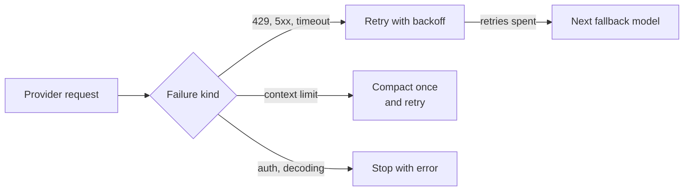

# Self-Recovery

The agent keeps a run going through provider failures, long contexts and stalls, and stops a run that no longer makes progress.

| Mechanism | Behaviour |
|-|-|
| Provider recovery | Failures are classified as transient (429, 5xx, timeouts), context limit, authentication or decoding. Transient ones are retried `model.max_retries` times with backoff or the server's `Retry-After`, then the next `model.fallback_models` entry is used (`provider:model` switches provider). A context-limit failure compacts the history once and retries. Nothing is retried after part of the answer has streamed. |
| Stream timeouts | A stream silent for `session.stream_idle_timeout` seconds, or running past `session.stream_total_timeout`, is treated as a transient failure. |
| Todo guard | When the model ends a turn with open `TodoWrite` items, it is asked to continue. After three reminders without progress it stops and reports the open items. Open items are restated after compaction. |
| `context_limit_recovery` | After a `max_tokens` stop, injects a continuation prompt quoting the last request. |
| `json_parse_recovery` | When a tool result fails JSON parsing, asks for valid JSON. |
| `ralph_loop_check` | On `end_turn`, asks the agent to finish `TODO`, `FIXME`, `NotImplemented`, `# 구현 필요` or `# 미구현` markers. End-of-turn hooks may continue a turn at most three times per prompt. |
| Repeat guard | The same tool call with identical arguments draws a warning at the third consecutive repeat and is refused at the fifth (`TaskGet` polling excepted). |
| Output bounds | A tool result stays inline up to 12,000 characters (and up to about 30,000 tokens; 10,000 for `WebFetch`). A longer result keeps its head and its tail in the conversation, and its full text is written to `~/.nerdvana/tool-output/session-<digest>/`; the note names the file so the model can read it back with `FileRead` or `Grep`. `tools.max_result_chars` overrides the limit per tool. |
